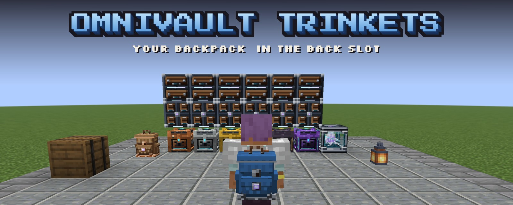
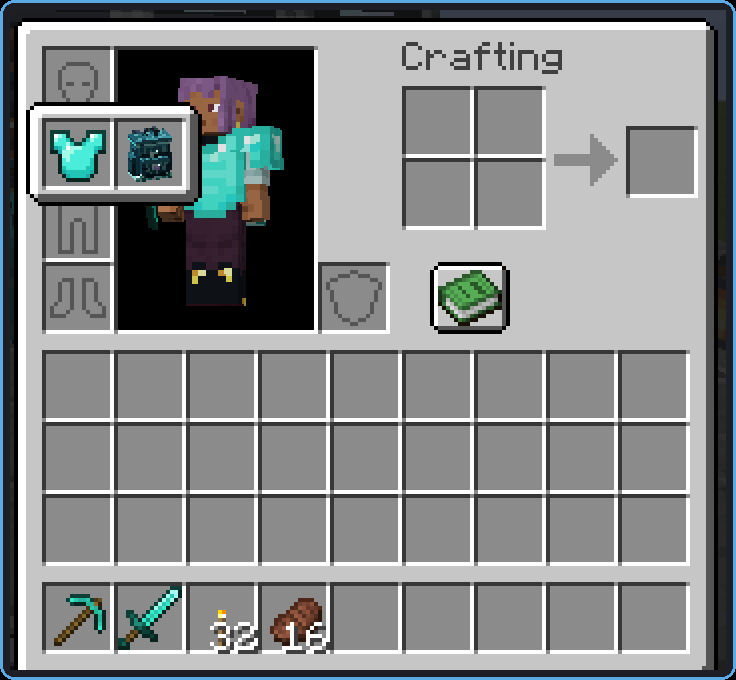
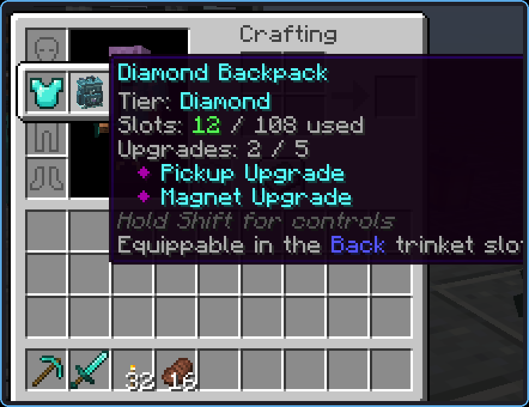
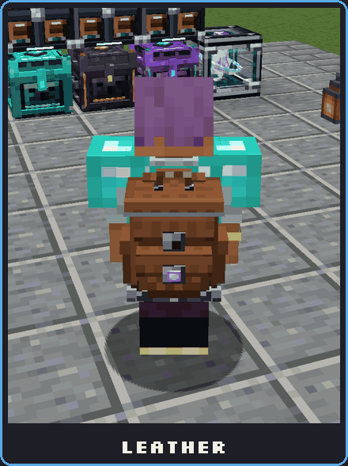
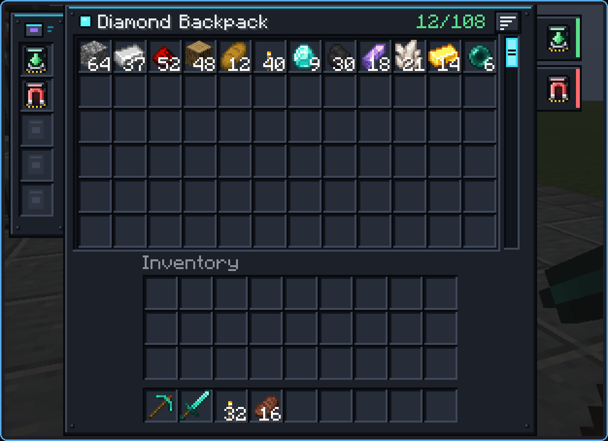

<b>Wear your <a href="https://modrinth.com/mod/omnivault">OmniVault</a> backpack in the <a href="https://modrinth.com/mod/curios">Curios</a> or <a href="https://modrinth.com/mod/trinkets-updated">Trinkets</a> back slot, and keep your chestplate on.</b>

Put the backpack in the **back** slot, next to your armour: with Trinkets, hover the chestplate slot to open the chest group; with Curios, it's the Back slot in the Curios panel. All six tiers fit, from Leather to Netherite, and a dyed leather backpack keeps its colour.

 

It shows on your back just like a backpack worn in the chest slot, sitting over any chestplate.

Press the backpack key (**B** by default) to open the backpack on your back. If you also wear one in the chest slot, that one opens first.

Upgrades keep working from the back slot:

| Upgrade | From the back slot |
|---|---|
| Pickup, Void | Take picked-up items |
| Magnet | Pulls nearby items to you |
| Feeding, Restock | Feed you and top up your hotbar |
| Compacting | Keeps compacting the contents |

Install on the **server**, and on the **client** too if you want to see the backpack on your back. Minecraft **26.3**, Java **25**. One jar per loader, with every slot mod it supports built in: install whichever slot mod you like.

| | Fabric | NeoForge |
|---|---|---|
| Required | [OmniVault](https://modrinth.com/mod/omnivault) 2.0.4+, [Fabric API](https://modrinth.com/mod/fabric-api) | [OmniVault](https://modrinth.com/mod/omnivault) 2.0.4+ |
| Back slot from | [Trinkets Updated](https://modrinth.com/mod/trinkets-updated) | [Curios API](https://modrinth.com/mod/curios) and/or [Trinkets Updated](https://modrinth.com/mod/trinkets-updated) |

[Accessories](https://modrinth.com/mod/accessories) support is planned for both loaders once Accessories is released for Minecraft 26.3. Curios has no Fabric release for 26.3.

This mod turns on the back slot for players (Curios `back`, Trinkets `chest/back`) and tags OmniVault's `#omnivault:backpacks` for it. It only hooks into OmniVault and the slot mods; none of their code or art is included.
